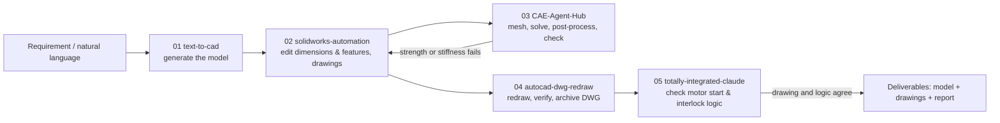

# Mechanical Design AI Skills — A Survey and Workflow

> Five open-source AI skills, wired into one loop: **requirement → model → edit → simulate → drawing → electrical check**.

I'm an undergraduate in Mechatronics Engineering. During my internship I built aluminium-profile frames, ran CNC jobs and debugged non-standard machines on the assembly floor; back at university I kept getting stuck on the same repetitive work — redrawing an old part, re-checking a bracket. This repository is my record of pulling a handful of mechanical-design AI skills off GitHub, reading them properly, and organising them into a workflow.

**Scope note**: this repository does **not** contain the source code of those five projects and is not a mirror of them. It is a **survey** — for each one it answers: what problem does it solve, what goes in and comes out, how do you actually run it, and where does it stop being trustworthy. Follow the links for the real code.

## Contents

| # | Stage | Project | One-line summary |
|:--:|---|---|---|
| 01 | Requirement → 3D model | [text-to-cad](docs/01-text-to-cad.md) | Natural language, or a Python `build123d` script, becomes a real parametric CAD model with a built-in viewer |
| 02 | Edit dimensions & features | [solidworks-automation](docs/02-solidworks-automation.md) | Drives a real SolidWorks instance over COM: change dimensions, rebuild features, produce drawings, verify delivery |
| 03 | Build the FEA pipeline | [cae-agent-hub](docs/03-cae-agent-hub.md) | MCP leaves that chain meshing, solving, post-processing and checking into an auditable simulation trail |
| 04 | Redraw & verify old drawings | [autocad-dwg-redraw](docs/04-autocad-dwg-redraw.md) | Rebuilds DWG from a source DWG, a PDF intermediate or an image plus authoritative dimensions — and validates it entity by entity |
| 05 | Read motor start conditions | [totally-integrated-claude](docs/05-totally-integrated-claude.md) | TIA Portal Openness to read and write PLC programs, including motor start-up, interlock and E-stop logic |

## Why these five

Together they cover the whole path from "an idea" to "something the shop floor can build", and every step lands in **real desktop software** rather than producing text about it:



Two loops matter here:

- **Geometry loop** — a failed simulation sends you back into SolidWorks to change a dimension, not to redraw from scratch.
- **Mechatronics loop** — once the drawings are final, you go back and check the PLC: motor start conditions, interlocks, E-stop. Otherwise you ship something that assembles but cannot move.

## What all five have in common

Read side by side, they are built on the same skeleton:

1. **Skill + tool + verification.** A `SKILL.md` describes when and how to act; an MCP server gives the model hands; a verification step proves the result.
2. **None of them equates a successful tool call with a finished task.** CAE-Agent-Hub wants every result checkable. The SolidWorks skill refuses to deliver a file that was not created or modified in the current run. The AutoCAD skill insists on entity-level validation instead of "it looks right". That discipline is the most valuable idea in the whole set.
3. **All of them need locally installed, licensed desktop software** (SolidWorks, AutoCAD, Abaqus, TIA Portal) driven through COM or Openness. A cloud model cannot replace that step.
4. **All of them target agent clients** — Claude Code, Codex, Cursor, Claude Desktop. In essence they give an LLM hands and a checklist.

## How I use them

- Install the skill into the agent environment I actually work in (the skills directory of my local DSH / Codex setup) so it triggers on demand.
- For the MCP-based ones, register the stdio server per each project's README (`mcp.json`).
- Before letting the AI touch anything, make it **state the acceptance criteria for that step** — dimensional tolerance, mesh quality, entity count. Check the result against those criteria; never accept "it looks fine".

## Boundaries and risks

- **Licensing and versions**: `autocad-dwg-redraw-skill` ships **no LICENSE file** — ask the author before using it. The TIA skills are pinned to the TIA Portal V21 Openness API; switching versions means re-running its own diagnostics.
- **It does not replace engineering judgement**: tolerances, materials, heat treatment and assembly interference are still human decisions. AI accelerates the repetitive generation and checking around them.
- **Accountability**: the person who signs the drawing or the simulation report owns it. Any report should state which parts were AI-generated and which were human-reviewed.
- **Environment cost**: four of the five need licensed commercial software. The real learning curve is environment setup, not code.

## Repository layout

```
mech-design-ai-skills/
├── README.md                  ← you are here
├── docs/
│   ├── 01-text-to-cad.md
│   ├── 02-solidworks-automation.md
│   ├── 03-cae-agent-hub.md
│   ├── 04-autocad-dwg-redraw.md
│   ├── 05-totally-integrated-claude.md
│   └── workflow.md            ← how the five connect, what flows between them, where it breaks
└── ATTRIBUTION.md             ← upstream repositories, authors, licences
```

## Acknowledgements

The five projects come from Thompson Labs (text-to-cad, CAE-Agent-Hub), the SolidWorks Automation Skill Contributors, pengxiaoan (autocad-dwg-redraw-skill) and Łukasz Czarnacki (totally-integrated-claude). Links and licences are listed in [ATTRIBUTION.md](ATTRIBUTION.md).

The writing in this repository is licensed MIT. Corrections and additions are welcome.
