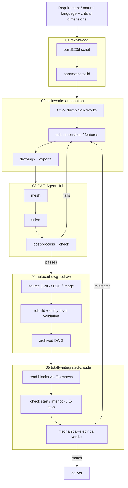

# Wiring the five together

This page connects the five skills: where each step gets its input, who receives the output, and what the acceptance criteria are.

## The picture

## What moves between the steps, and what to verify

| Step | Input from | Output to | Acceptance criteria to state first |
|:--:|---|---|---|
| 01 | human requirement, critical dimensions | 02 | key dimensions, feature count, no interference |
| 02 | geometry from 01 | 03 / 04 | dimensional tolerances, features fully rebuilt, export created in this run |
| 03 | model from 02 | 02 (on rework) | mesh quality metrics, boundary-condition list, result within an experienced range |
| 04 | model from 02 + old drawing / PDF | 05 | entity count matches the source, key dimensions match the authoritative values |
| 05 | drawings from 04 + PLC project | delivery | motor start conditions, interlocks and E-stop map to the drawing annotations one by one |

## Three places it actually breaks

1. **Units and coordinate systems.** Each tool has its own defaults (mm/m, assembly vs part origin). Cross-step geometry is most fragile here — declare units and frames explicitly at every hand-off.
2. **"Looks right" versus "is right".** Steps 02 and 04 both ship verification, but the criteria are yours to define. Without them an AI will settle for "I checked it".
3. **Licence and version.** 02 needs SolidWorks, 04 needs AutoCAD, 05 needs TIA Portal V21. A version bump can break the MCP layer; get the environment diagnostics green before discussing workflow.

## If you only need one

If your job is "redraw one old drawing" or "check one bracket", do not force the whole chain — install 04 or 03 alone. The chain pays off on **multi-round iteration**: modify → check → redraw → verify logic, three or four times over. That is when the saved time becomes real.
